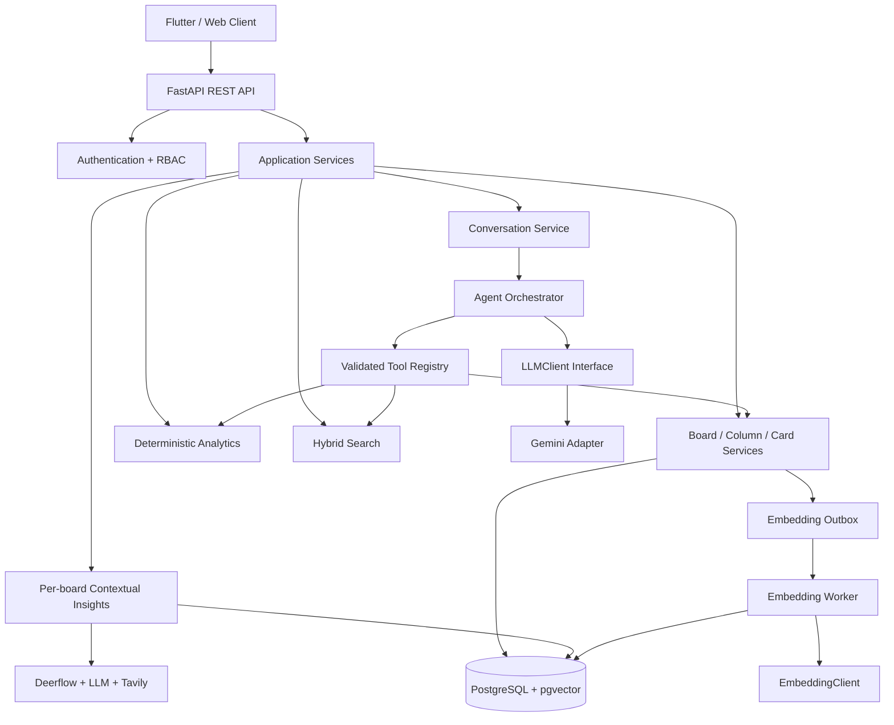
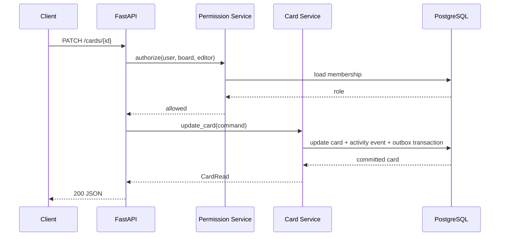
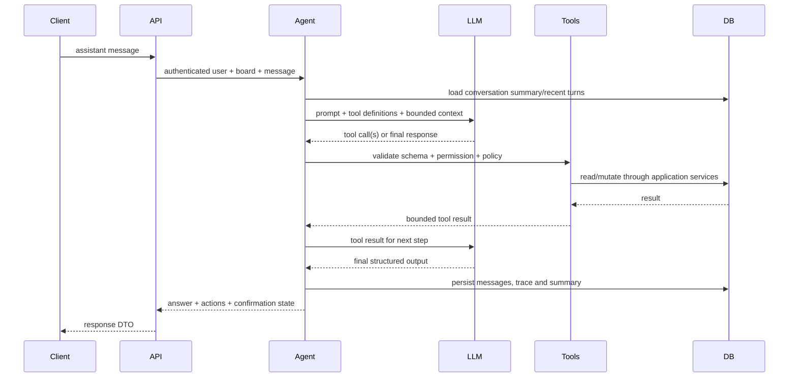

# 02 · Architecture

## Decision

**[NEW]** Use a modular monolith: one FastAPI application, PostgreSQL + pgvector, and a background embedding worker. This is small enough for the four-day MVP and keeps boundaries clear for later extraction.

**[ORIGINAL]** Historical client/backend: Flutter, Firebase Authentication, Cloud Firestore, Hive cache, GetX, and Gemini-powered board generation. A separate Deerflow + LLM + Tavily workflow was implemented and working for per-board contextual insight generation, although it was intermittently unreliable. It was never the board-generation engine. The rebuild replaces Firebase as the backend system of record and should preserve then harden this insight capability.

## Components

1. **API:** FastAPI routers, auth dependencies, Pydantic DTOs, rate limiting.
2. **Application services:** boards, columns, cards, membership, invitations, conversations, search, analytics, agent orchestration.
3. **Domain:** state transitions, permission policies, prioritisation rules, analytics calculations.
4. **Persistence:** SQLAlchemy 2.x repositories, PostgreSQL transactions, Alembic migrations.
5. **Agent:** provider-neutral LLM client, planner, tool registry, confirmation policy, output validation.
6. **Search:** provider-neutral embedding client, outbox, worker, pgvector + full-text retrieval, RRF fusion.
7. **Per-board contextual insights:** [ORIGINAL] Deerflow + LLM + Tavily insight generation for an individual board. [NEW] Port/reconnect it behind a provider boundary and harden its reliability.
8. **Observability:** structured logs, request IDs, tool traces, token/latency metrics.

## System diagram



## Normal mutation flow



## Agent request flow



## Per-board insight flow

**[ORIGINAL]** The previous product generated contextual insights for an individual board through Deerflow + an LLM + Tavily. This capability was working, though intermittent failures occurred. It is independent of the Gemini goal-to-board flow and independent of the new tool-calling agent loop.

**[NEW]** The Python service should gather an authorized board snapshot and deterministic analytics, then call a `BoardInsightProvider` adapter. Keep Deerflow orchestration and Tavily research behind that boundary. Validate the result, persist run status and report metadata, and return either the latest successful insight report or a clearly labelled analytics-only fallback. Do not assume the old integration's internal topology or exact failure cause without inspecting its source.

## Provider boundary

**[NEW]** Define `LLMClient` as a Protocol/ABC with `generate(messages, tools, response_schema, temperature) -> LLMResponse`. Gemini adapter translates normalized messages/tool definitions into the SDK format and normalizes provider output. The orchestrator must not import Gemini SDK types. Define a separate `EmbeddingClient` because chat and embedding providers/models may differ.

**[ASSUMPTION]** Gemini is the first adapter because the earlier product used Gemini. Keep model IDs in environment configuration and verify the currently supported model and embedding dimensions during implementation.

## Safety and transaction boundaries

- Every mutation goes through an application service, never model-generated SQL.
- `user_id` comes from authenticated server context, never LLM arguments.
- Re-check board membership and role for every tool call.
- Write mutation and activity event in one transaction.
- Use outbox records for asynchronous embeddings.
- Require confirmation for bulk or ambiguous mutations.
- Bound agent iterations, tool calls, context size and execution time.
- Treat card text and retrieved content as untrusted data, not system instructions.

## Suggested repository layout

```text
boardbuddy/
  app/
    api/routes/        # HTTP layer
    core/              # settings, security, logging
    domain/            # policies and domain rules
    schemas/            # Pydantic DTOs/tool schemas
    services/           # application services
      agent/ search/ analytics/
    llm/                # interfaces + Gemini adapter
    db/                 # SQLAlchemy models, repos, session
    workers/            # embedding outbox worker
    main.py
  migrations/
  prompts/
  tests/unit/ tests/integration/ tests/evals/
  Dockerfile docker-compose.yml pyproject.toml
```
